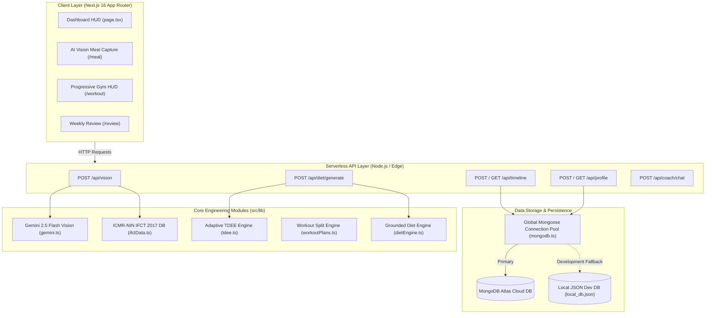
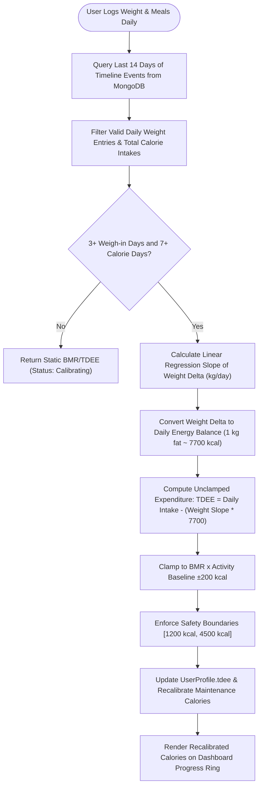
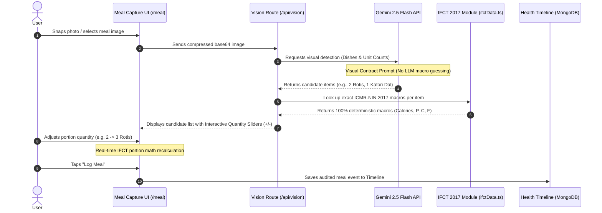
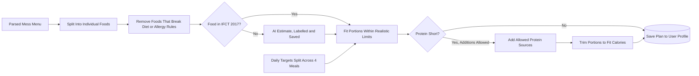
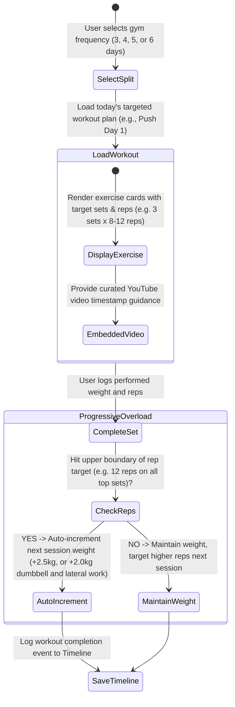

# Health OS Architecture & Engineering Specification 🏛️

This document outlines the system architecture, mathematical algorithms, data pipeline models, and security principles powering **Health OS**.

---

## 📐 System Overview Diagrams

### Diagram 1: High-Level System Architecture & Data Pipelines

---

### Diagram 2: 14-Day Rolling Linear Regression Adaptive TDEE Loop (MacroFactor Paradigm)

---

### Diagram 3: 4-Stage Perfect Vision & ICMR-NIN IFCT 2017 Portion Engine

---

### Diagram 4: Mess-Based Diet Planner

---

### Diagram 5: Double Progression Workout & Progressive Overload Engine

---

## 🗄️ Database Schemas & Data Models

### 1. `UserProfile` Schema (`src/lib/db/models.ts`)
Stores identity, physical biometrics, calculated TDEE, mess menu configurations, and generated diet plans.

Key Compound Indexes:
- `{ email: 1 }` (Unique Index, stored lowercase)

### 2. `TimelineEvent` Schema (`src/lib/db/models.ts`)
Central event log storing all user health activities (meals, workouts, weights, sleep, water).

Key Compound Indexes:
- `{ userId: 1, timestamp: -1 }` (Fast chronological timeline rendering)
- `{ userId: 1, type: 1, timestamp: -1 }` (Filtered type queries for TDEE regression & weekly reviews)

---

## 🔌 Serverless Connection Pooling & Development Fallback

Health OS uses a **dual-layer database connection manager** (`src/lib/mongodb.ts` & `src/lib/db/fallback.ts`):
1. **Primary Layer**: `connectDB()` attaches the Mongoose connection promise to `global._mongooseCache` to prevent connection pool exhaustion across serverless cold starts.
2. **Development Fallback Layer**: In development only, if MongoDB is unreachable the system falls back to local JSON file persistence (`local_db.json`). In production these routes return `503` instead.

---

## 🔐 Authentication & Data Isolation

- **Login**: A 6-digit code is emailed to the user. Challenges are stored in the `OtpChallenge` collection as HMAC hashes, are single-use, expire after 5 minutes, and lock after 5 wrong guesses. Sending is limited to one code per 30 seconds and 5 per hour.
- **Sessions**: A successful login sets an HTTP-only, `SameSite=Lax` cookie signed with HMAC-SHA256 using `AUTH_SECRET` (`src/lib/auth/session.ts`). Sessions are stateless and last 30 days, so they cannot be revoked individually before expiry. Rotating `AUTH_SECRET` ends all of them.
- **Isolation**: API routes take the user's identity only from the session, and every event lookup filters by the session's `userId`. A test fails if a route outside `/api/auth` does not check the session.
- **Timezones**: The browser's timezone is stored in the session, so "today", streaks, and weekly windows follow the user's calendar rather than the server's UTC clock (`src/lib/dateUtils.ts`).
