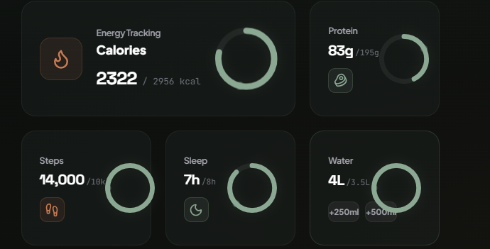
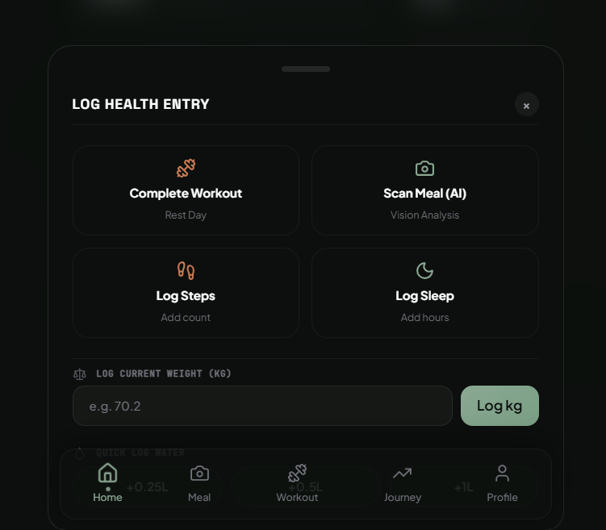
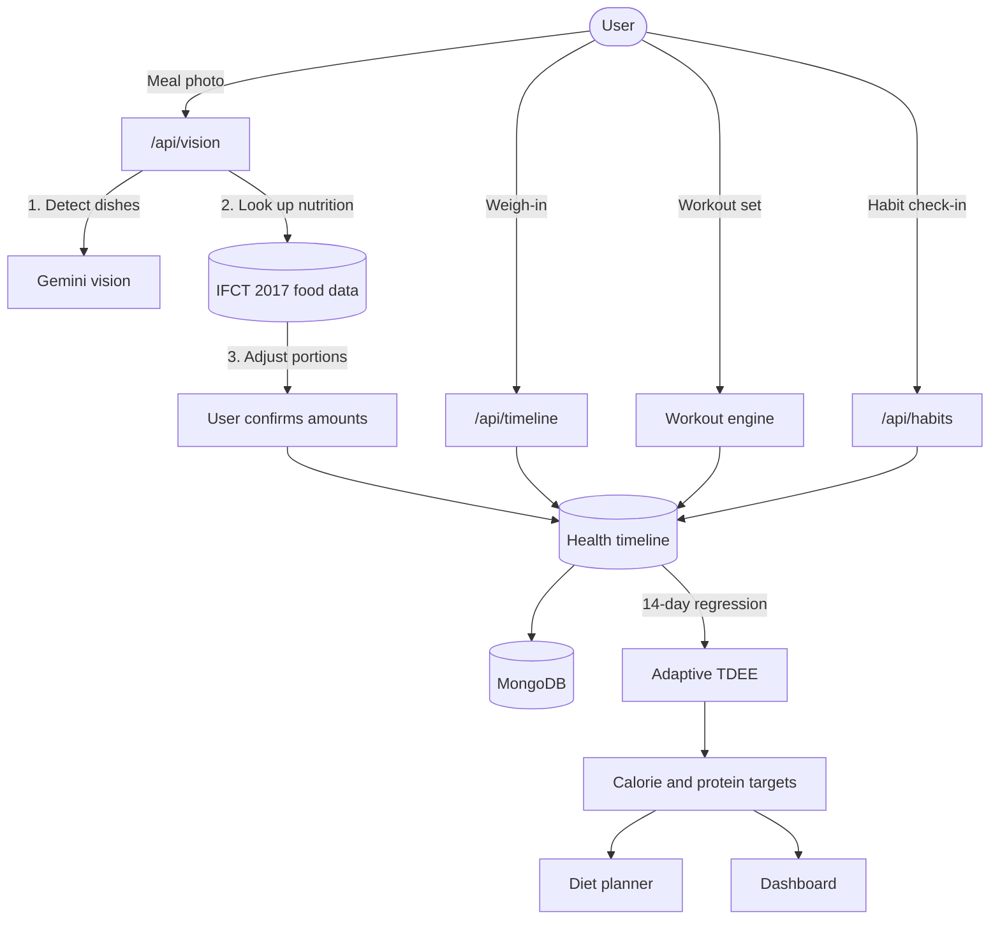

<div align="center">


# Health OS

**A health and fitness tracker built for hostel students in India.**
Log meals, workouts, weight, sleep and habits, and let the app adjust your targets from your real data.

[](https://github.com/AdityaThakur193/HealthOs/actions/workflows/ci.yml)
[](https://nextjs.org/)
[](https://www.typescriptlang.org/)
[](https://www.mongodb.com/)
[](src/__tests__)
[](LICENSE)

[Features](#features) · [Screenshots](#screenshots) · [Getting started](#getting-started) · [Project layout](#project-layout) · [Architecture](docs/ARCHITECTURE.md) · [API](docs/API.md)

</div>

> [!NOTE]
> **This project is no longer actively developed.** This repository is an early open-source version of Health OS, kept public for reference and learning. New features and fixes are not published here, and issues and pull requests may not get a response. The code stays under the AGPLv3 licence, so you are free to fork it.

---

## Features

| Feature | What it does |
| :--- | :--- |
| **Adaptive calorie target** | Estimates your real daily energy use (TDEE) from 14 days of weigh-ins and logged calories, instead of relying only on a formula. Starts once there are at least 3 weigh-ins and 7 logged days, and stays within safe limits. |
| **Meal photos with real nutrition data** | AI identifies the dishes and counts in a photo. Calories and macros come from the **ICMR-NIN IFCT 2017** Indian food tables, not from the AI. You adjust portions (katori, pieces, scoops) before saving. |
| **Mess menu logging** | Pick what you took from today's mess menu and confirm the amounts. Nothing is saved until you confirm. |
| **Mess-based diet plan** | Builds a day of meals from what your mess actually serves, with realistic portions, and says plainly when a target can't be reached. AI estimates are used only for dishes IFCT doesn't cover, and are labelled. |
| **Workout plans with progression** | Templates for 3 to 6 training days a week that you can edit. Suggests adding weight once every top set reaches the top of the rep range. |
| **AI coach** | A chat coach that can log meals, water, sleep, steps, weight and habits from plain language. It knows mess hours and never suggests a meal that has closed. |
| **Habits and weekly review** | Streaks and completion rates for daily habits, plus a Sunday review with specific actions for next week. |
| **Meal reminders** | Optional push notification in the last hour before a meal closes, only if that meal isn't logged yet. |
| **Secure by default** | Email one-time-code login, signed HTTP-only sessions, and every read and write scoped to the signed-in user. See [SECURITY.md](SECURITY.md). |

## Screenshots

<p align="center">
  
  &nbsp;
  
</p>

## How it works

Every action (a meal, a workout set, a weigh-in, a habit check-in) is saved as an event on one **health timeline**. The calculation engines read that timeline to update your targets.



More detail, including the maths behind each engine, is in [docs/ARCHITECTURE.md](docs/ARCHITECTURE.md). Every API route is documented in [docs/API.md](docs/API.md).

## Tech stack

- **App:** Next.js 16 (App Router), React 19, TypeScript, Tailwind CSS, Framer Motion
- **Data:** MongoDB with Mongoose 8
- **AI:** Google Gemini for meal photos, Groq for the coach and text meal analysis
- **Email and notifications:** Resend for login codes, Web Push for reminders
- **Testing:** Vitest, Testing Library, and an in-memory MongoDB for API integration tests

## Getting started

**You need:** Node.js 20.9 or newer, and a MongoDB database (Atlas or local).

```bash
git clone https://github.com/AdityaThakur193/HealthOs.git
cd HealthOs
npm install
```

Copy `.env.local.example` to `.env.local` and fill it in. The example file explains each value. The minimum for local development is:

```env
MONGODB_URI=mongodb+srv://<username>:<password>@cluster0.mongodb.net/healthos
GEMINI_API_KEY=your_gemini_api_key
GROQ_API_KEY=your_groq_api_key
```

In development, the login code is printed in the server console, so `RESEND_API_KEY` can stay empty. Production also needs `AUTH_SECRET` (at least 32 characters) and `RESEND_API_KEY`.

Then start the app and open [http://localhost:3000](http://localhost:3000):

```bash
npm run dev
```

### Checks

```bash
npm run lint         # ESLint
npm run type-check   # TypeScript
npm test             # Vitest (368 tests in 27 files)
npm run build        # Production build
```

### Meal reminders

Reminders are sent by `POST /api/cron/reminders`, which needs `CRON_SECRET` and VAPID web push keys. The workflow [.github/workflows/reminders.yml](.github/workflows/reminders.yml) can call it, given an `APP_URL` repository variable and a `CRON_SECRET` secret. In this repository it only runs manually; add a `schedule` trigger in your fork to run it every 15 minutes.

## Project layout

```
HealthOs/
├── src/
│   ├── app/                 # Pages (App Router) and API routes
│   │   ├── api/             # auth, coach, cron, diet, habits, mess-menu, profile,
│   │   │                    # reminders, review, timeline, vision, workout-plan
│   │   ├── page.tsx         # Home dashboard
│   │   ├── meal/            # Meal photo and mess menu logging
│   │   ├── diet/            # Diet plan
│   │   ├── workout/         # Workout plan and logging
│   │   ├── habits/          # Habit tracker
│   │   ├── journey/         # Weight trend and progress
│   │   ├── review/          # Weekly review
│   │   ├── profile/         # Settings, mess hours, reminders
│   │   ├── onboarding/      # First-run setup
│   │   └── login/           # Email code sign-in
│   ├── components/          # UI components
│   ├── hooks/               # React hooks
│   ├── lib/                 # Engines and shared logic
│   │   ├── tdee.ts          # Adaptive TDEE
│   │   ├── ifctData.ts      # IFCT 2017 food data and lookup
│   │   ├── dietPlanner.ts   # Mess-based diet planner
│   │   ├── workoutPlans.ts  # Workout templates and progression
│   │   ├── habitEngine.ts   # Habit streaks and scores
│   │   ├── coach*.ts        # Coach actions, context and rules
│   │   ├── reminders.ts     # Meal reminder logic
│   │   ├── auth/            # Sessions and login codes
│   │   └── db/              # Mongoose models
│   ├── data/                # Generated IFCT dataset
│   └── __tests__/           # Unit, component and API integration tests
├── public/                  # Icons, PWA manifest, service worker
├── scripts/                 # Data build scripts
└── docs/                    # Architecture, API reference, screenshots
```

## Known limitations

- **No offline logging.** The app can be installed to the home screen, but needs a connection to log data.
- **Approximate AI rate limits.** Limits are counted per server instance, so they are approximate on serverless hosts.
- **Sessions can't be revoked one by one.** They last 30 days. Rotating `AUTH_SECRET` ends all of them.

## Medical disclaimer

Health OS is an informational wellness tool, not a medical device. Its calorie targets, diet plans, meal analysis and workout plans are for education only and do not replace advice from a doctor or registered dietitian. Talk to a professional before starting a new diet or training programme, especially if you have an injury or medical condition. The author accepts no liability for harm resulting from its use.

## Food data

Nutrition values come from the **Indian Food Composition Tables (IFCT 2017)**, ICMR National Institute of Nutrition.

## License

Licensed under the [GNU Affero General Public License v3.0](LICENSE), with an attribution requirement under section 7(b): forks and hosted versions must keep the original credits to **Aditya Thakur** and share their source under AGPLv3.

Built by [Aditya Thakur](https://github.com/AdityaThakur193).
